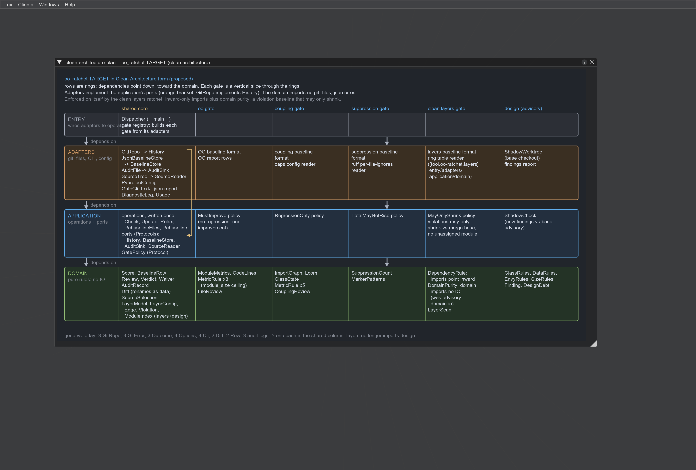

# Clean Architecture plan

Two linked efforts, tracked in Linear:

- **PL-1709**, the tool: `oo-ratchet` drives Clean Architecture in the repos
  that adopt it.
- **PL-1710**, this repo: `oo_ratchet` itself moves to Clean Architecture,
  as the first adopter of every PL-1709 feature.

This follows PL-1685 (PR #27). That change stopped the OO gate pushing code
into tiny one-class modules, and made a branch be judged against the merge
base.

## The target model

Four rings. Imports point only inward, and the domain imports no IO.

| Ring | Holds | May import |
|------|-------|------------|
| `domain` | metric values, rules, baseline rows, reviews and verdicts, design findings, audit records | nothing outside the domain; no `subprocess`, `os`, `pathlib`, `json`, sockets |
| `application` | the operations (`Check`, `Update`, `Relax`, `RebaselineFiles`, `Rebaseline`), written once for every gate; the ports as `Protocol`s (`History`, `BaselineStore`, `AuditSink`, `SourceReader`); `GatePolicy` | `domain` |
| `adapters` | `GitRepo` (implements `History`), the JSON baseline and audit files, config readers, report rendering | `application`, `domain` |
| `entry` | `__main__`, each gate's CLI, wiring each gate's adapters to its operations | everything |

Each gate is a vertical slice through the rings:

- **domain:** its scorer and rules;
- **application:** its comparison policy;
- **adapters:** its baseline format.

| Gate | Policy |
|------|--------|
| `oo` | must improve, no regression |
| `coupling` | no regression |
| `suppression` | the total may not rise |
| clean `layers` | violations may only shrink |
| `design` | advisory: reports new findings against the merge base |

The **clean layers ratchet** enforces the model, on adopters and on this repo:

- **DependencyRule:** imports point inward.
- **DomainPurity:** the domain imports no IO. This promotes today's advisory
  `domain-io` rule into a gate.
- **The baseline may only shrink** against the merge base.

## Starting point (main at c825334)

Measured with this repo's own tool:

- **Imports:** one cycle between modules (`package_graph.py`):
  `source_archive` imports the `ArchiveRepo` protocol from `source_rescan`
  under `TYPE_CHECKING`, and `source_rescan` imports `SourceArchive` at run
  time. Moving that protocol into the application ring as a port (A2) removes
  it. Between packages there are no cycles
  once the root package's entry modules (`__main__`, `gates`) are counted
  apart from its shared modules (`source_set`, `backfill`, ...). Counted as one
  root package, every package sits in one cycle: `gates` imports each gate's
  `cli`, and every gate imports `source_set`. The entry ring in the target
  removes that cycle. The dependency graph runs
  `entry → layers → design → oo/coupling → core`. The largest
  edge is `layers → design`, with 22 imports: the layers gate runs on code
  that lives in the advisory design package.
- **Duplication:** 7 class names are defined in more than one gate: `GitRepo`
  (in `oo`, `coupling` and `suppression`), `Cli`, `Options`, `Outcome`,
  `Diff`, `GitError`, `Row`. There are three audit logs, each with a
  9-parameter `append`.
- **OO gate:** 1 module of 131 fails a target: complexity 12 in
  `coupling/metrics.py`.
- **Coupling gate:** 6 files over a cap: the two package `__init__` export
  files, `coupling/cli.py`, the two `gitio.py` classes, and
  `design/class_rules.py`.
- **Suppressions:** 19.
- **Design check:** 153 advisory findings. 43 `primitive-params`, 40
  `concrete-cross-package-import`, 24 `data-clump`, 13 `feature-envy`, 13
  hollow classes (8 function bags, 5 single-method classes), 10 `size-cap`,
  and 10 others.

### Ring counts

The four-ring table for `src/oo_ratchet` is the `[tool.oo-ratchet.layers]` table in `pyproject.toml`.
Modules are placed by role; the table lists every pattern and module it names.
The main ones: `*.gitio`, `*.baseline`, `*.audit`, `*.report`, `*.outcome`,
config readers such as `coupling/config` and the `source_*` modules are
adapters; `*.ratchet`, `*.compare`, `*.bless`, `*.relax`, `*.writer`, `*.rescan`,
`*.apply`, `*.scan`, the `shadow*` modules, `backfill` are application; `__main__`, `gates`, `usage`,
`logging_config` and `*.cli` are entry; every module the table does not name is
domain. The counts below were measured on the `src/oo_ratchet` of main 987f57b
with the table of `docs/architecture/four-rings.toml` as added in b4b85a5
(137 files scanned, 243 findings). Reproduce them: extract `src` of 987f57b
(`git archive 987f57b src`), save `git show b4b85a5:docs/architecture/four-rings.toml`
to a file and run `uv run oo-ratchet design src/oo_ratchet/ --layers <that file> --json`.
The current tree, with the table in `pyproject.toml`, is measured by
`uv run oo-ratchet design src/oo_ratchet/ --json` from the repository root:
139 files scanned, 248 findings; `layer-import` 130, `domain-io` 9,
`thick-entry` 9.

| Rule | Count |
|------|-------|
| `layer-import` | 130 |
| `concrete-cross-package-import` | 40 |
| `size-cap` | 10 |
| `domain-io` | 9 |
| `primitive-params` | 9 |
| `stateless-function-bag` | 8 |
| `feature-envy` | 7 |
| `stateless-single-method` | 5 |
| `getter-heavy` | 3 |
| `split-cohesion` | 3 |
| `middle-man` | 2 |
| `envied-data` | 1 |
| `thick-entry` | 9 |
| `data-clump` | 6 |
| `tag-switch` | 1 |
| `unlayered-module`, `misplaced-function` | 0 |

The 130 `layer-import` violations by importing ring and the ring imported:

| From | Imports | Count |
|------|---------|-------|
| domain | adapters | 42 |
| domain | entry | 12 |
| domain | application | 21 |
| application | adapters | 55 |

Entry and adapters import nothing outward. 54 of the 130 are in the four package
`__init__.py` files (`oo`, `coupling`, `layers`, `suppression`), which are
domain by the table and import the modules they export, most of them in the
outer rings. The most
imported outer modules are `source_set` (17), `coupling/outcome` (7),
`oo/baseline` (7), `coupling/gitio` (6), `oo/compare` (6), `oo/audit` (6) and
`oo/gitio` (6).

The 9 `thick-entry` findings are methods of the four CLI modules (`oo`, `coupling`,
`suppression`, `layers`) whose complexity exceeds 4 (`oo/cli.py` `Cli._run_action` is 10). The 9 `domain-io`
findings are in 8 modules: 6 import `pathlib`
(`coupling/packages`, `coupling/scorer`, `design/layer_table`,
`design/modules`, `oo/scorer`, `suppression/scanner`), 2 import `io`
(`oo/code_lines`, `suppression/patterns`) and `oo/scorer` also imports `json`.

With layers configured, `primitive-params` applies only to domain modules
(9, against 43 without layers), `feature-envy` is 7 (13 without) and
`data-clump` is 6 (24 without), because entry and adapter modules are
excluded.

`adopter_shape.py src/oo_ratchet` reports, without layers: 131 modules
(excluding `__init__`), module size median 62 (p25 38, p75 98, max 256), 36
modules of at most 40 code lines, 0 over the 400-line ceiling, and classes per
module of 0 (10 modules), 1 (116) and 2 (5).

An intermediate target, gates above one shared core, came before the ring
form. It is kept for comparison:

## Units

**PL-1709, the tool:**

| Unit | Linear | What |
|------|--------|------|
| B1 | PL-1711 | clean layers ratchet: DomainPurity enforced, four rings as the documented default |
| B2 | PL-1713 | `layers --suggest`: a starter ring table built from each module's imports |
| B3 | PL-1715 | design rules scoped by ring |
| B4 | PL-1716 | measure design-rule precision on vox, quarry, lux and z-spec; gate the rules that are right ≥ ~90% of the time |
| B5 | PL-1712 | average complexity and average params become ceilings |
| B6 | PL-1714 | `layers --json` adds each module's ring and the edges between rings, for diagrams |
| B7 | PL-1717 | release 0.7.0, adoption guide, rollout to the adopter repos |

**PL-1710, this repo:**

| Unit | Linear | What |
|------|--------|------|
| A0 | PL-1718 | measure: write the four-ring table, record the starting counts |
| A1 | PL-1719 | turn on the clean layers ratchet here, with today's violations as the baseline |
| A2 | PL-1720 | shared contract: ports, domain types, operations written once, one adapter set; `ArchiveRepo` becomes a port, ending the one module cycle |
| A3 | PL-1721 | move each gate onto the contract: `suppression` first, then the rest in parallel |
| A4 | PL-1722 | class debt: split `SourceSet`, `MetricRule` objects, fold the hollow classes, objects decide for themselves |
| A5 | PL-1723 | method and signature debt: feature envy, complexity, long signatures, data clumps |

### A2 decisions

The shared core lives in `src/oo_ratchet/core/` with `domain/`, `application/`
and `adapters/`. The layers table in `pyproject.toml` names each ring. The
glob `oo_ratchet.*.baseline` matches across dots, so a core module is never
named after an existing ring pattern (`audit`, `baseline`, `report`, `cli`).

- **Domain types are frozen data.** `Score`, `BaselineRow`, `Measurement`,
  `Metric`, `Waiver`, `FileReview`, `Review`, `Failure`, `Verdict`,
  `AuditRecord`, `Diff` (renames as a dict), `SourceSelection` (strings, no
  `Path`) and `StateError`/`GitError`. The domain imports no IO module.
- **A baseline is `Rows`**, `{path: {metric: number}}`, the shape the OO and
  coupling gates already write. Gate-specific metric sets differ only in the
  `GatePolicy` table.
- **`GatePolicy` holds the differences between gates**: the metric table
  (target, direction, ceiling) and three flags. `must_improve` (OO true,
  coupling false), `absolute_targets` (a new file or a metric missing from the
  base row is judged by its target; OO true, coupling reports it as info) and
  `lock_rows` (the in-tree baseline must equal the scores of every touched or
  rewritten file; OO true, coupling false).
- **Four ports plus `ArchiveRepo`.** `History` has five methods (`resolve`,
  `baseline_at`, `audit_at`, `changes_since`, `head`), `BaselineStore` three,
  `AuditSink` two, `SourceReader` three (`measure`, `exists`, `key`).
  `ArchiveRepo` moved from `source_rescan` into `core.application.ports`;
  `source_archive` and `source_rescan` import it under `TYPE_CHECKING`, which
  ends the one module cycle. It keeps its private `_git` member until A3
  deletes the three `GitRepo` copies.
- **Operations return a `Verdict`, not text.** A failure is a `Failure(kind,
  subjects)`; `GateCli` maps kinds to messages. `Check`, `Update`, `Relax`,
  `RebaselineFiles` and `Rebaseline` take a `GatePolicy` and a `Ports` bundle.
- **The CI-write guard is an adapter concern.** `GateCli.write_blocked` reads
  `GITHUB_ACTIONS`; the operations never read the environment.
- **Audit waivers come from `AuditRecord.waivers_since`**: records the base log
  does not already carry, with verdict `relaxed` or `rebaseline-files`, matched
  by a key that ignores key order.
- **Path spellings** for `RebaselineFiles` are normalised by
  `SourceReader.key`, implemented by `SourceTree`.
- **One `GitRepo` adapter** (`core/adapters/gitrepo.py`) is built from the two
  file names of a gate. It reads the baseline and audit blobs through
  `BaselineFormat` and `AuditFormat`.
- **Not in A2, left to A3:** `reconcile` (the whole-tree sweep), the
  suppression gate's total-and-ceiling-ledger comparison and its different
  audit and baseline formats, `PyprojectConfig` reading each gate's own table,
  and the `LayerModel` move out of `design` (`LayerConfig`, `Edge`,
  `Violation`, `ModuleIndex`), which touches 38 imports from `layers`.
- **Tests.** `tests/core/` runs the operations against in-memory ports in
  under a second. `tests/core_real/` holds the real-git `GitRepo` tests and
  the equivalence tests: each scenario runs the existing OO gate through
  `oo_ratchet.oo.cli.main` and the new operations on the same repository, and
  the verdicts must match.

## Order

| Wave | In parallel | Waits on |
|------|-------------|----------|
| 1 | B1, A0, B5 | — |
| 2 | A1, B2, B6 | B1, A0 |
| 3 | A2 | A1 |
| 4 | A3 (`suppression` first, then `oo`, `coupling`, `layers`, `design`), B3 | A2; B3 waits on B1 |
| 5 | A4, A5, B4 | A3, B3 |
| 6 | B7 | PL-1710 done, B2, B4, B6 |

Each unit gets its own worktree. It takes at most 3 hours (1 for the small
ones), and its first commit comes within 30 minutes. That commit is a test
that fails on the old behavior.

Each unit's PR proves itself:

- `make check` is green;
- this repo's self-gates pass against the merge base;
- the clean layers count is lower (from A1 on);
- the vox demo is unchanged.

## Done when

- The clean layers ratchet reports 0 violations on this repo.
- No class name is defined in more than one gate.
- Design findings are down from 153, with each rule's count recorded.
- vox, quarry, lux and z-spec run the clean layers ratchet with their own
  baselines.

## Decisions (recommendations)

1. `layers --suggest` writes a starter table for a person to correct. It is
   never applied automatically, because a wrong ring silently passes bad
   imports.
2. Adapters are exempt from the hollow-class rules. A thin adapter around one
   git command is correct design.
3. Adopters start from their own baseline and shrink at their own pace. This
   repo goes to zero.

## Diagrams

The PNGs above are lux screenshots. Each was drawn with a single `draw`
element (ImGui draw-list primitives) through lux's `scene_show` tool. The
generators are in `docs/architecture/tools/`:

| Script | Draws |
|--------|-------|
| `class_diagram.py <repo> <out.json>` | the current state, from the live code and `oo-ratchet design --json`; rerun after each unit |
| `target_diagram.py <out.json>` | the intermediate target (hand-specified) |
| `clean_diagram.py <out.json>` | the four-ring target (hand-specified) |
| `package_graph.py <repo>/src/oo_ratchet [--one-root]` | prints the package import edges, then every package cycle and every module cycle (strongly connected components, `TYPE_CHECKING` imports included); `--one-root` groups the entry modules with the shared root modules. `test_graph_tools.py` tests the cycle finder (`uv run pytest docs/architecture/tools/test_graph_tools.py`) |

Three measurement scripts sit beside them:

| Script | Measures |
|--------|----------|
| `demo_targets.py <adopter> <src> <main-checkout> <branch-checkout>` | the vox demo: modules, across the whole tree, that miss an absolute OO target (the targets a new file must meet), `main`'s build versus a branch's (runs `uvx --from <checkout> oo-ratchet` with the adopter as the working directory) |
| `adopter_shape.py <src>` | module size distribution, classes per module, and design finding counts (run with `uv run --directory <repo> python ...`) |
| `compare_checks.py <repo>` | the OO gate and the design check on each `evals/design` bad/good pair |

All three read the gate through `oo_json.py`. It runs `oo-ratchet --json`, stops
with a message when the command is missing, prints no JSON, or cannot score a
file, and checks each value against the target that run reported.

The three diagram scripts each write one lux `draw` element as JSON;
`package_graph.py` and the measurement scripts above print plain text. To
show a diagram:

1. Wrap it in a lux render request:
   `{"scene_id": "<id>", "elements": [<element>], "title": "<title>",
   "frame": {"size": [1500, 840]}}`.
2. Run `lux display start`, then `lux scene show <id> --from request.json`.
3. Capture the image with lux's `display_screenshot` tool.

Run `class_diagram.py` with `uv run --directory <repo> python ...`, because
it calls `oo-ratchet`.
B6 (PL-1714) replaces the current-state script with `layers --json`.
