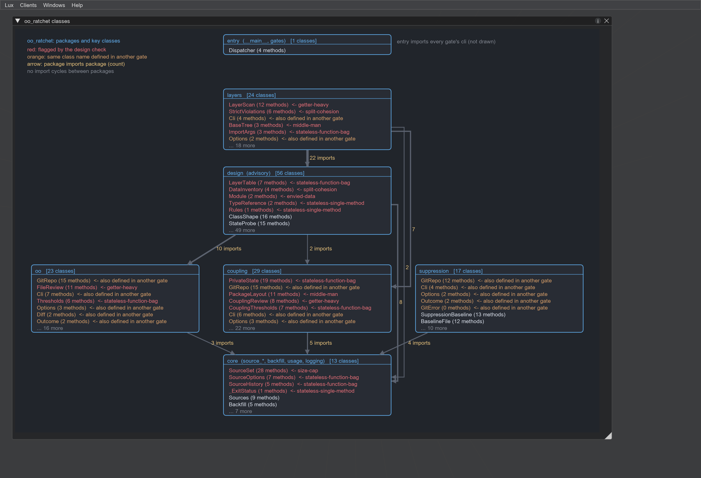
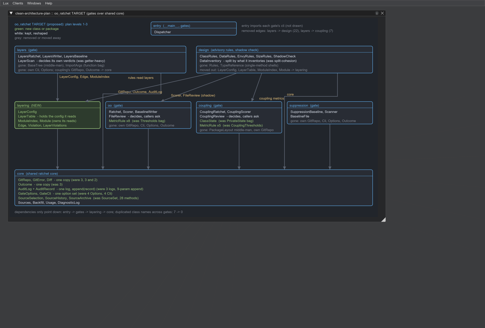

# Clean Architecture plan

Two linked efforts, tracked in Linear:

- **PL-1709**, the tool: `oo-ratchet` drives Clean Architecture in the repos
  that adopt it.
- **PL-1710**, this repo: `oo_ratchet` itself moves to Clean Architecture,
  as the first adopter of every PL-1709 feature.

This follows PL-1685 (PR #27). That change stopped the OO gate pushing code
into tiny one-class modules, and made a branch be judged against the merge
base.

## The target model

Four rings. Imports point only inward, and the domain imports no IO.

| Ring | Holds | May import |
|------|-------|------------|
| `domain` | metric values, rules, baseline rows, reviews and verdicts, design findings, audit records | nothing outside the domain; no `subprocess`, `os`, `pathlib`, `json`, sockets |
| `application` | the operations (`Check`, `Update`, `Relax`, `RebaselineFiles`, `Rebaseline`), written once for every gate; the ports as `Protocol`s (`History`, `BaselineStore`, `AuditSink`, `SourceReader`); `GatePolicy` | `domain` |
| `adapters` | `GitRepo` (implements `History`), the JSON baseline and audit files, config readers, the CLI and report rendering | `application`, `domain` |
| `entry` | `__main__`, wiring each gate's adapters to its operations | everything |

Each gate is a vertical slice through the rings:

- **domain:** its scorer and rules;
- **application:** its comparison policy;
- **adapters:** its baseline format.

| Gate | Policy |
|------|--------|
| `oo` | must improve, no regression |
| `coupling` | no regression |
| `suppression` | the total may not rise |
| clean `layers` | violations may only shrink |
| `design` | advisory: reports new findings against the merge base |

The **clean layers ratchet** enforces the model, on adopters and on this repo:

- **DependencyRule:** imports point inward.
- **DomainPurity:** the domain imports no IO. This promotes today's advisory
  `domain-io` rule into a gate.
- **The baseline may only shrink** against the merge base.

## Starting point (main at c825334)

Measured with this repo's own tool:

- **Imports:** no cycles between modules, and none between subpackages. The
  dependency graph runs `layers → design → oo/coupling → core`. The largest
  edge is `layers → design`, with 22 imports: the layers gate runs on code
  that lives in the advisory design package.
- **Duplication:** 7 class names are defined in more than one gate: `GitRepo`
  (in `oo`, `coupling` and `suppression`), `Cli`, `Options`, `Outcome`,
  `Diff`, `GitError`, `Row`. There are three audit logs, each with a
  9-parameter `append`.
- **OO gate:** 1 module of 131 fails a target: complexity 12 in
  `coupling/metrics.py`.
- **Coupling gate:** 6 files over a cap: the two package `__init__` export
  files, `coupling/cli.py`, the two `gitio.py` classes, and
  `design/class_rules.py`.
- **Suppressions:** 19.
- **Design check:** 153 advisory findings. 43 `primitive-params`, 40
  `concrete-cross-package-import`, 24 `data-clump`, 13 `feature-envy`, 13
  hollow classes (8 function bags, 5 single-method classes), 10 `size-cap`,
  and 10 others.

A0 (PL-1718) replaces this section with the ring-based counts.

An intermediate target, gates above one shared core, came before the ring
form. It is kept for comparison:

## Units

**PL-1709, the tool:**

| Unit | Linear | What |
|------|--------|------|
| B1 | PL-1711 | clean layers ratchet: DomainPurity enforced, four rings as the documented default |
| B2 | PL-1713 | `layers --suggest`: a starter ring table built from each module's imports |
| B3 | PL-1715 | design rules scoped by ring |
| B4 | PL-1716 | measure design-rule precision on vox, quarry, lux and z-spec; gate the rules that are right ≥ ~90% of the time |
| B5 | PL-1712 | average complexity and average params become ceilings |
| B6 | PL-1714 | `layers --json` adds each module's ring and the edges between rings, for diagrams |
| B7 | PL-1717 | release 0.7.0, adoption guide, rollout to the adopter repos |

**PL-1710, this repo:**

| Unit | Linear | What |
|------|--------|------|
| A0 | PL-1718 | measure: write the four-ring table, record the starting counts |
| A1 | PL-1719 | turn on the clean layers ratchet here, with today's violations as the baseline |
| A2 | PL-1720 | shared contract: ports, domain types, operations written once, one adapter set |
| A3 | PL-1721 | move each gate onto the contract: `suppression` first, then the rest in parallel |
| A4 | PL-1722 | class debt: split `SourceSet`, `MetricRule` objects, fold the hollow classes, objects decide for themselves |
| A5 | PL-1723 | method and signature debt: feature envy, complexity, long signatures, data clumps |

## Order

| Wave | In parallel | Waits on |
|------|-------------|----------|
| 1 | B1, A0, B5 | — |
| 2 | A1, B2, B6 | B1, A0 |
| 3 | A2 | A1 |
| 4 | A3 (`suppression` first, then `oo`, `coupling`, `layers`, `design`), B3 | A2; B3 waits on B1 |
| 5 | A4, A5, B4 | A3, B3 |
| 6 | B7 | PL-1710 done, B2, B4, B6 |

Each unit gets its own worktree. It takes at most 3 hours (1 for the small
ones), and its first commit comes within 30 minutes. That commit is a test
that fails on the old behavior.

Each unit's PR proves itself:

- `make check` is green;
- this repo's self-gates pass against the merge base;
- the clean layers count is lower (from A1 on);
- the vox demo is unchanged.

## Done when

- The clean layers ratchet reports 0 violations on this repo.
- No class name is defined in more than one gate.
- Design findings are down from 153, with each rule's count recorded.
- vox, quarry, lux and z-spec run the clean layers ratchet with their own
  baselines.

## Decisions (recommendations)

1. `layers --suggest` writes a starter table for a person to correct. It is
   never applied automatically, because a wrong ring silently passes bad
   imports.
2. Adapters are exempt from the hollow-class rules. A thin adapter around one
   git command is correct design.
3. Adopters start from their own baseline and shrink at their own pace. This
   repo goes to zero.

## Diagrams

The PNGs above are lux screenshots. Each was drawn with a single `draw`
element (ImGui draw-list primitives) through lux's `scene_show` tool. The
generators are in `docs/architecture/tools/`:

| Script | Draws |
|--------|-------|
| `class_diagram.py <repo> <out.json>` | the current state, from the live code and `oo-ratchet design --json`; rerun after each unit |
| `target_diagram.py <out.json>` | the intermediate target (hand-specified) |
| `clean_diagram.py <out.json>` | the four-ring target (hand-specified) |
| `package_graph.py <repo>/src/oo_ratchet` | prints the package import edges and any cycles |

Three measurement scripts sit beside them:

| Script | Measures |
|--------|----------|
| `demo_targets.py <adopter> <src> <main-checkout> <branch-checkout>` | the vox demo: modules failing a new-file OO target, `main`'s build versus a branch's (runs `uvx --from <checkout> oo-ratchet` with the adopter as the working directory) |
| `adopter_shape.py <src>` | module size distribution, classes per module, and design finding counts (run with `uv run --directory <repo> python ...`) |
| `compare_checks.py <repo>` | the OO gate and the design check on each `evals/design` bad/good pair |

Each script writes one lux `draw` element as JSON. To show it:

1. Wrap it in a lux render request:
   `{"scene_id": "<id>", "elements": [<element>], "title": "<title>",
   "frame": {"size": [1500, 840]}}`.
2. Run `lux display start`, then `lux scene show <id> --from request.json`.
3. Capture the image with lux's `display_screenshot` tool.

Run `class_diagram.py` with `uv run --directory <repo> python ...`, because
it calls `oo-ratchet`.
B6 (PL-1714) replaces the current-state script with `layers --json`.
